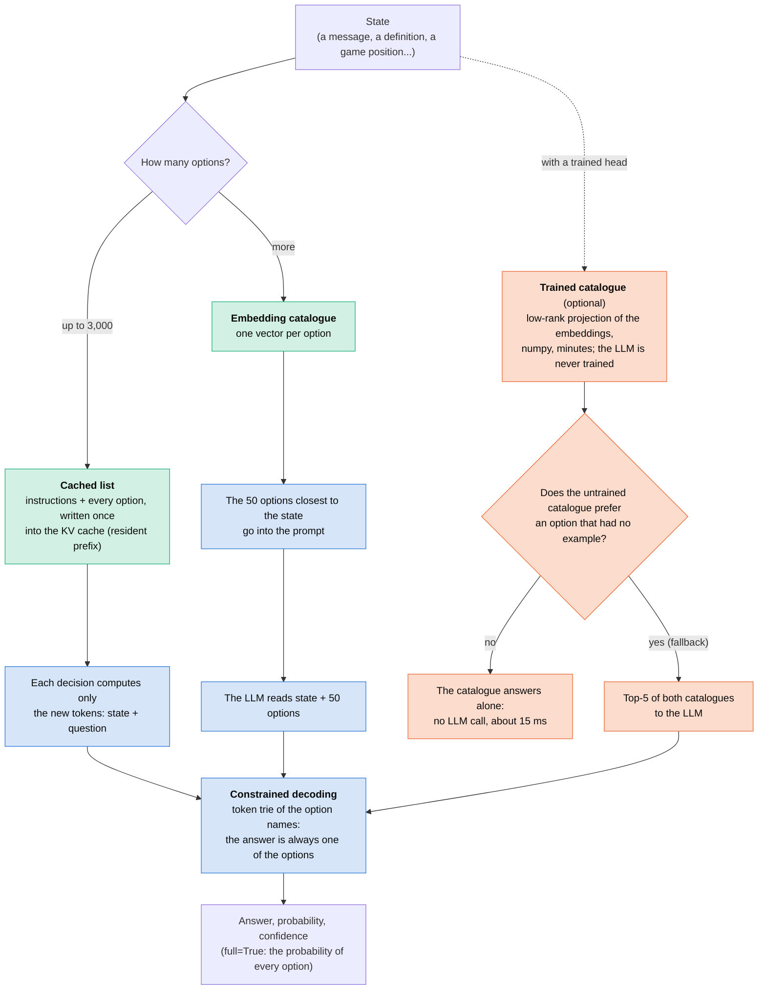
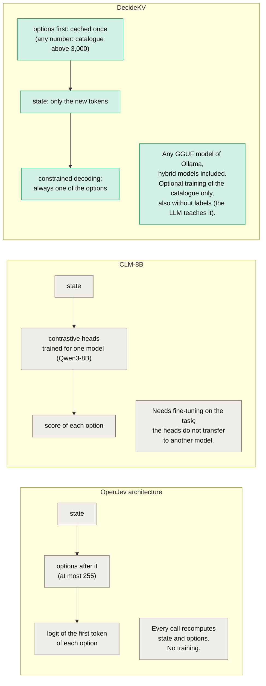

# DecideKV

**Fast decisions over many options with a local LLM.**

`decidekv` picks one option out of a list for a given state (a message, a definition, the state of a game) with
a local LLM. It is a tool, not a new method: it packages known techniques so that one call does the right thing
at every list size.

- **Up to 3,000 options** the whole list is written once into the model's KV cache. Each decision then computes
  only the tokens of the new state, and the answer is decoded so that it can only be one of the options.
- **Above 3,000 options** an embedding catalogue selects the 50 options closest to the state and the LLM chooses
  among them.
- **Optionally**, the catalogue can be trained on examples of your own task in minutes, also on typed questions
  and also without labels (the LLM labels your states). Only a small projection of the embedding vectors is
  trained; the LLM is never trained. Trained on Typed Decisions, the catalogue alone reaches 75.6% with no LLM call.

It speaks the `Choice` / `Score` / `Noul` question types of [OpenJev](https://github.com/GPT-AGI/OpenJev), runs on
any GGUF model that [Ollama](https://ollama.com) has downloaded (pure-attention and hybrid recurrent models alike),
and works with any embedding model.

A short paper describes the idea and the comparisons: **[paper/arxiv/main.pdf](paper/arxiv/main.pdf)**.
The measurements and their protocol are written up in **[paper/decidekv.md](paper/decidekv.md)**; this README has the
instructions and the same tables.

```python
from decidekv import KV

kv = KV("qwen3:8b", embed="qwen3-embedding:4b")
intents = kv.index(["card arrival", "lost or stolen card", "refund not showing up"],
                   noun="intent", state_label="Customer message",
                   question="Which intent does this customer message express?")
intents.choose("I ordered my card two weeks ago and it's still not here").choice
# 'card arrival'
```

## Install

Download the repository (green **Code** button, **Download ZIP**, or `git clone`) and install it from its folder:

```bash
git clone https://github.com/HGarrone/decidekv
cd decidekv
pip install -e ".[llamacpp]"         # the library, llama-cpp-python, numpy
ollama pull qwen3:8b                 # any pure-attention GGUF model
ollama pull qwen3-embedding:4b       # any embedding model; only needed above 3,000 options or for training
```

On Windows, if loading the model crashes with "illegal instruction", the installed `llama-cpp-python` wheel was
built for a CPU feature the machine lacks. This command downloads the matching official llama.cpp build and
checks its SHA-256:

```bash
python -m decidekv.get_llamacpp
```

Run the offline tests with `pip install pytest` and `pytest`.

## Usage

### Which mode for which kind of state

Measured on three datasets (see the results): the right shortcut depends on what the states look like.

| Kind of state | Recommended | Why |
|---|---|---|
| **Structured** (records, game states, agent traces, forms) | `kv.decide(...)`: the LLM with the prefix tree, **no cache** | similar-looking structured states often need different answers: the semantic cache and the catalogue lose accuracy, and the prefix tree already gives the speed |
| **Short natural-language messages** (requests, e-mails, chat) | a **trained catalogue** (`kv.train` / `kv.teach`) for speed; or the LLM with `cache=0.95` to keep exactly its answers | many messages look alike: the catalogue answers in the time of one embedding, the cache reuses the LLM's answers for near-duplicates |

### One list of options, many states

```python
from decidekv import KV

kv = KV("qwen3:8b", embed="qwen3-embedding:4b")
tools = kv.index({"search_flights": "find flights between two cities",
                  "book_hotel": "reserve a hotel room",
                  "cancel_booking": "cancel an existing reservation"},
                 noun="tool", state_label="User request", question="Which tool should be called?")

answer = tools.choose("I need a room in Rome from Friday to Sunday")
answer.choice        # 'book_hotel'
answer.confidence    # probability of the decoded answer
```

`tools.choose(state, full=True)` returns the probability of every option in `answer.probabilities` instead of
the decoded one only (also `kv.decide(..., full=True)` and `tools.scores(state)` for the raw log-probabilities).
Options whose probability falls below 10⁻⁶ are bounded instead of computed. On Qwen3-8B with the 77 intents of
Banking77 this costs 50 ms per decision, the same as the greedy choice; on the hybrid 27B about 2.3 s, because
llama.cpp can evaluate few sequences at once on models with recurrent layers.

Options are a list of names or a `{name: description}` dictionary. `noun`, `state_label` and `question` are
written into the prompt: naming things for the model helps.

`kv.index` returns the right kind of index for the size of the list. Up to `flat_max` options (3,000 by default,
`KV(..., flat_max=...)`) the list lives in the KV cache; above it the embedding catalogue is used and `k` (50 by
default) options are shown to the LLM.

### Several typed questions about one state

```python
from decidekv import KV, Choice, Score, Noul

r = kv.decide(
    state={"customer": "This is the third time I write! My card was stolen yesterday."},
    questions={
        "intent": Choice(instructions="What is the customer's request?", options=["lost or stolen card", "refund"]),
        "mood": Score(instructions="How upset is the customer?", criteria=["calm", "annoyed", "furious"]),
        "escalate": Noul(instructions="Should this be escalated to a human right now?"),
    },
)
r.answers["intent"].choice, r.answers["mood"].score, r.answers["escalate"].noul
```

When several questions with short option lists are asked about a long state, `decide` puts the state first in the
prompt and keeps it in the cache for all of them, so the state is computed once per turn instead of once per
question (`order="auto"`, the default; `order="options"` or `"state"` force one order).

### Semantic cache (short natural-language messages)

`cache=0.95` reuses the LLM's answer for a state whose embedding has a cosine of at least 0.95 with a state already
answered; it needs an embedding model. It works per index (`choose`) and per question (`decide`):

```python
kv = KV("qwen3:8b", embed="qwen3-embedding:4b")
intents.choose(message, cache=0.95)              # intents.semantic.hits / .misses
r = kv.decide(state, questions, cache=0.95)      # r.cached lists the questions answered from the cache
```

Keep it for repetitive natural-language messages: on structured states it lowers accuracy even at 0.98.

### Trial and error

`exclude=` removes options from the decoding, so an attempt that was already refuted cannot be chosen again:

```python
tried = []
while True:
    cell = grid.choose(game_state, exclude=tried).choice
    if shoot(cell):
        break
    tried.append(cell)
```

### Training the catalogue on your own examples

When you have examples of the form (state, right option) for a fixed list of options, the catalogue can learn
from them. Training is optional and is switched off unless you call it.

```python
examples = [("I still haven't received my new card", "card arrival"), ...]      # a few thousand pairs

head = kv.train(options, examples, question="Which intent does this customer message express?",
                out="intents_head.npz")
head.report          # validation accuracy before and after, epochs, seconds

intents = kv.index(options, head=head, question="Which intent does this customer message express?")
intents.choose("where is my card?").choice
```

With a trained head the catalogue decides alone (no LLM call) unless you pass `k` greater than 1. A head belongs
to the embedding model and to the list of options it was trained with. Options without training examples are
answered worse; a fallback to the LLM (`fallback=5`, the default) recovers part of the loss (see the results), but
training with examples for every option you care about works best.

### Training on typed questions, with or without labels

The catalogue can also learn `Choice`, `Score` and `Noul` questions, each with its own options. An answer can be an
option name, a level, `True`/`False`, a probability, or a distribution `{key: probability}` (soft labels).

```python
# (state, question, answer): e.g. (ticket, Noul(...), True) or (ticket, Score(...), {"0": 0.2, "1": 0.8})
examples = [...]
head = kv.train_questions(examples, out="typed_head.npz")
# layout="state-once": the state is embedded once per call, ~6x faster, a few points less accurate
r = kv.decide(state, questions, head=head)            # the trained catalogue answers alone: no LLM call
```

Without labels, the LLM labels your states and the catalogue learns its answers (the probability of every option,
not only the best one):

```python
examples = kv.teach([(state, questions) for state in my_states])
head = kv.train_questions(examples)
```

The catalogue then answers in the time of the embedding calls instead of an LLM call per question, with about the
accuracy of its teacher (see the results).

A trained head and the LLM can also work as a cascade: the head answers every question and only the answers below
a confidence threshold go to the LLM, in one call (`r.escalated` lists them):

```python
r = kv.decide(state, questions, head=head, threshold=0.5)
```

### Any embedding model

`embed` is the name of an embedding model downloaded by Ollama, or any function that maps a list of texts to
L2-normalised vectors. The text sent to the embedding model for a state is `query_template`:

```python
kv = KV("qwen3:8b", embed="bge-m3", query_template="{state}")
kv = KV("qwen3:8b", embed=my_function)          # my_function(list_of_texts) -> array of unit vectors
```

The default template, `"Instruct: {question}\nQuery:{state}"`, suits instruction-tuned embedding models such as
Qwen3-Embedding.

### Prompts in another language

The fixed words of the prompt are templates (`decidekv.core.WORDING`); override them for your language:

```python
italian = {"intro": "Sei un motore di decisione.{task} Rispondi alla domanda sul {state} scegliendo un {noun} "
                    "dalla lista di {plural}. {reply}

",
           "reply_name": "Rispondi con l'{noun} esattamente come scritto nella lista{part}, e nient'altro.",
           "part": " (solo la parte prima dei due punti)", "plural": "intenti",
           "question": "Quale {noun} corrisponde al {state}?", "question_title": "Domanda"}
intenti = kv.index(["arrivo carta", "carta rubata"], noun="intento", state_label="Messaggio", wording=italian)
```

### Engines

`KV(model)` runs llama.cpp in the Python process and reads the GGUF file from Ollama's model folder (or a `.gguf`
path). The option list of an index is a *resident prefix*: it is evaluated once in a sequence of its own and copied
into the working sequence at every decision, so only the new tokens are computed. This works on every architecture,
including models with recurrent layers (Qwen3.5/3.8, Mamba, Jamba…), and up to `resident` lists (7 by default,
`KV(model, resident=...)`) stay cached at the same time, so alternating between indexes recomputes nothing. Keep
`resident` at 7 or less on models with recurrent layers: with more sequences llama.cpp decodes them up to ten times
slower.

When a list is used with its own question (one list, many states), the question goes before the state, so
instructions, options and question are one cached prefix (`question_first=True`, the default;
`KV(..., question_first=False)` puts it after the state). When several questions share one list, as in `decide`, the
list stays one cached prefix and the question goes after the state, so that the questions do not compete for the
resident slots.
`n_ctx` (16,384 tokens by default) must hold the option lists; `kv_type="q8_0"` halves the memory of the cache;
`kv_on_gpu=False` keeps the cache in system memory when the weights fill the GPU. `KV(model, backend="ollama")`
talks to the Ollama server instead: it gives the same kind of answers, but the confidence of a choice is not available
there (it is reported as 0), the server recomputes the list on hybrid models, and every number below was measured
with the llama.cpp engine unless stated. Call `kv.close()` to free the GPU.

`KV(model, backend="llamaserver")` uses a llama.cpp `llama-server`: DecideKV starts one on the model with the
llama.cpp build it finds (`n_ctx`, `slots`, `port`, `kv_type` go to `LlamaServer.start`), or
`KV(model, backend="llamaserver", host="http://127.0.0.1:8080")` connects to a server you started yourself with
several slots (`-np`). Each resident prefix gets a slot of its own; one slot is kept for the other prompts, and each
slot holds `n_ctx / slots` tokens. Use it to share one loaded model between programs or to run the model on another
machine. Answers are decoded with a grammar of the option names, so they are always one of the options; `full=True`
is not available on this engine.

Above 3,000 options the catalogue vectors can be kept on disk between runs:
`kv.index(options, vectors=Catalog.cached(texts, kv.encoder, "cache_folder"))` with `from decidekv.catalog import
Catalog` (at 30,000 options this saves about 30 seconds per start).

## How it works

The flow of one decision:



The same request in three designs:



**Why it matters.** The same model, prompt blocks and machine give, per decision: Banking77 63.0% in 64 ms for
DecideKV against 39.7% in 90 ms for the OpenJev architecture (Qwen3-8B), 72.0% in 163 ms against 45.7% in 409 ms on
a hybrid 27B; DecideKV keeps working at 30,000 options where OpenJev stops at 255; with the catalogue trained on the
task it reaches 93.0% in 15 ms on Banking77 and 75.6% with no LLM call on Typed Decisions, above CLM-8B with heads
fine-tuned on the same tasks (84.3% and 71.0%), on any model instead of one. The tables below have every number.

In a causal LLM the keys and values of a token depend only on the tokens before it. With the options first and
unchanged, their KV cache is computed once and reused exactly by every later call (the cells are shared by the
working sequence; on models with recurrent layers the recurrent state is copied, a few milliseconds); the state's
tokens then attend to every token of every option. The answer is decoded through a trie of the option names, so it is always one of
the options. Above a few thousand options the list no longer pays for itself in the cache, and the standard
retrieve-then-rerank pipeline takes over.

## Results

Same machine (RTX 4070 SUPER, 12 GB), same model (Qwen3-8B, llama.cpp, KV cache `q8_0`), same queries and the same
prompt blocks for every method measured here. Every cell is accuracy · median time per decision. The tables are
generated from the files in `results/` by `python benchmarks/report.py`.

### Against other tools

<!-- table:comparison -->
| Method | Training | Banking77 (77 intents) | WordNet (200 words) | Typed Decisions | Aim game (games won, time per shot) |
|---|---|---|---|---|---|
| **DecideKV** | none | 63.0% · 64 ms | 74.7% · 36 ms | 56.7% · 41 ms | 100.0% · 160 ms |
| **DecideKV, trained catalogue** | on the task | 93.0% · 15 ms | – | 75.6% · 57 ms | – |
| OpenJev architecture, shared prompt | none | 39.7% · 90 ms | 63.3% · 132 ms | 59.3% · 67 ms | 25.0% · 423 ms |
| OpenJev library, own prompt, Ollama | none | 44.0% · 117 ms | 22.7% · 164 ms | 58.1% · 62 ms | 25.0% · 469 ms |
| CLM-8B as released | none | 4.3% · 35 ms | 12.7% · 21 ms | 36.8% · 79 ms | 15.0% · 124 ms |
| CLM-8B, heads fine-tuned | on the task | 84.3% · 21 ms | 26.0% · 21 ms | 71.0% · 79 ms | – |
| Embedding model alone | none | 65.7% · 16 ms | – | – | – |
| Embedding top-50, then LLM | none | 58.3% · 127 ms | – | – | – |
| State-first prompt, constrained decoding | none | 61.0% · 138 ms | – | – | – |
| Cross-encoder, one LLM call per option (30 messages) | none | 70.0% · 1,589 ms | – | – | – |
<!-- /table:comparison -->

- *OpenJev architecture*: OpenJev's design (state first, options after it, answer read from the logits of the
  first token of each option) re-implemented in `benchmarks/baselines.py` on the shared prompt and engine. It is
  not the OpenJev library.
- *OpenJev library* and both *CLM-8B* rows come from `results/reference_qwen3_8b.json`: earlier measurements of
  this project on the same machine and model weights, made with scripts that are not part of the repository.
  CLM-8B is Qwen3-8B plus the released CLM-v0.1-8B heads.
- Banking77: 300 test messages. WordNet: 150 definitions, 200 candidate words. Typed Decisions: 2,000 decisions.
  DecideKV answers the five questions of a Typed Decisions case in one `decide` call (state first, the default).
  Aim game: 20 games on a 15×15 grid, at most 25 shots.

### The same comparison on a hybrid 27B model

Qwen3.8-27B (IQ2_S, architecture `qwen35`: recurrent and attention layers). Same tasks, prompt and engine; CLM-8B
cannot run here because its released heads belong to Qwen3-8B. Context of 8,192 tokens for Typed Decisions and the
aim game, so that the 9.3 GB of weights and the cache fit in 12 GB:

<!-- table:hybrid27b -->
| Method | Banking77 (77 intents) | WordNet (200 words) | Typed Decisions | Aim game (games won, time per shot) |
|---|---|---|---|---|
| **DecideKV** | 72.0% · 163 ms | 84.7% · 106 ms | 70.4% · 193 ms | 100.0% · 339 ms |
| OpenJev architecture, shared prompt | 45.7% · 409 ms | 84.0% · 600 ms | 69.1% · 307 ms | not measured: over two hours (the whole grid is recomputed at every shot) |
<!-- /table:hybrid27b -->

With a 16,384-token context the same aim game took 1.25 s per shot on this model: the weights and the cache
filled the 12 GB and part of the cache spilled into system memory. Keep `n_ctx` to what the lists need.

### Growing lists

WordNet reverse dictionary (definition → word), 600 definitions:

<!-- table:scale -->
| Options | Index chosen by `KV.index` | Accuracy | Time per decision | Index build | Right answer among the 50 candidates |
|---|---|---|---|---|---|
| 1,000 | Index | 66.0% | 40 ms | 1 s | – |
| 3,000 | Index | 58.3% | 47 ms | 2 s | – |
| 10,000 | TopKIndex | 53.3% | 85 ms | 10 s | 89.5% |
| 30,000 | TopKIndex | 51.0% | 96 ms | 28 s | 86.5% |
<!-- /table:scale -->

The same task with 150 definitions, next to the tools that were measured on it:

<!-- table:scale150 -->
| Options | DecideKV | OpenJev architecture | CLM-8B as released | CLM-8B, heads fine-tuned |
|---|---|---|---|---|
| 200 | 74.7% · 37 ms | 63.3% · 132 ms | 12.7% · 21 ms | 26.0% · 21 ms |
| 1,000 | 58.7% · 39 ms | not supported (max 255) | 4.7% · 21 ms | 16.7% · 21 ms |
| 3,000 | 60.7% · 46 ms | not supported (max 255) | 4.0% · 21 ms | 10.7% · 21 ms |
| 10,000 | 52.7% · 81 ms | not supported (max 255) | 3.3% · 21 ms | 8.7% · 21 ms |
| 30,000 | 48.0% · 89 ms | not supported (max 255) | not measured | not measured |
<!-- /table:scale150 -->

### Training the catalogue

Banking77, catalogue trained with `kv.train` on the public training split:

<!-- table:training -->
| Banking77, 300 test messages | Untrained catalogue | Trained catalogue |
|---|---|---|
| Catalogue alone (no LLM call) | 65.7% · 15 ms | 93.0% · 15 ms |
| Catalogue top-5, then LLM | 62.3% · 84 ms | 61.0% · 84 ms |
| Catalogue top-50, then LLM | 58.3% · 133 ms | 55.3% · 131 ms |
| Validation accuracy during training | 71.2% | 92.4% |
| Cost of training | – | 10,003 examples, 92 s in total (17 s of training, the rest is embedding the examples) |
<!-- /table:training -->

After training the catalogue is more accurate alone than followed by the LLM, and it answers in the time of one
embedding. The same catalogue configuration measured by two programs (`baselines.py` and `train_bench.py`) gives
56.3% and 56.0% for "top-50, then LLM": 1 message out of 300.

A catalogue trained with the examples of half of the intents only:

<!-- table:heldout -->
| Intent of the test message | Untrained catalogue | Trained on half of the intents, no fallback | Trained on half of the intents, fallback (default) | Decisions that fell back to the LLM |
|---|---|---|---|---|
| Had training examples (39 intents) | 66.0% · 16 ms | 95.4% · 16 ms | 85.0% · 16 ms | 15.0% |
| Had no training example (38 intents) | 65.3% · 16 ms | 21.1% · 16 ms | 61.2% · 84 ms | 63.9% |
<!-- /table:heldout -->

Without the fallback the head trained on half of the intents gets the other half wrong: it picks an intent it
was trained on, with high confidence, so the confidence cannot flag these errors. The fallback uses another signal:
the head records which options had examples, and when the untrained catalogue prefers an option without examples
and disagrees with the trained one, the LLM chooses among the 5 best options of each catalogue. On the intents
without examples this raises the accuracy from 21.1% to 61.2%; on the intents with examples it costs 10 points,
because the LLM re-chooses some cases the trained catalogue had right. Over all 300 messages: 59.0% without the
fallback, 73.3% with it, 65.7% for the untrained catalogue. A head trained on every option never falls back (93.0%
in 15 ms, as above). `fallback=0` switches it off.

### Training the catalogue on typed questions

Typed Decisions: the catalogue is trained with `kv.train_questions` on the training split (1,200 cases, 6,000
decisions of type `Choice`, `Score` and `Noul`) and answers the test split alone, with no LLM call. The teacher rows
use no human label at all: `kv.teach` lets the LLM answer the training cases (the probability of every option, with
the options-first prompt of the previous version) and the catalogue learns those answers.

<!-- table:typedtrain -->
| Typed Decisions, 2,000 test decisions | Labels used for training | Accuracy · time per decision |
|---|---|---|
| Catalogue alone, untrained | none | 44.5% · 57 ms |
| Catalogue alone, trained on the official answers | 6,000 human labels (most probable answer) | 75.4% · 57 ms |
| **Catalogue alone, trained on the official distributions** | 6,000 human labels (soft) | 75.6% · 57 ms |
| Catalogue alone, trained on the answers of Qwen3-8B (`kv.teach`) | none (the 8B labels the training states in 6 min) | 50.4% · 57 ms |
| Catalogue alone, trained on the answers of Qwen3.8-27B (`kv.teach`) | none (the 27B labels the training states in 42 min) | 66.6% · 57 ms |
| Same, state embedded once (`layout="state-once"`), official distributions | 6,000 human labels (soft) | 67.2% · 9 ms |
| Same, state embedded once, answers of Qwen3.8-27B | none | 60.8% · 9 ms |
| *DecideKV with Qwen3-8B, no catalogue* | none | 56.7% · 41 ms |
| *DecideKV with Qwen3.8-27B, no catalogue* | none | 70.4% · 193 ms |
| *CLM-8B, heads fine-tuned* | 6,000 human labels | 71.0% · 79 ms |
<!-- /table:typedtrain -->

- Trained on the human labels, the catalogue alone is the most accurate method measured on this task, ahead of
  CLM-8B with fine-tuned heads, in about the time of one LLM call of the 8B model. Soft labels (the official
  distribution) and hard labels (its most probable answer) end within 0.2 points of each other.
- Trained on the answers of an LLM, the catalogue reproduces its teacher: 50.4% for the 8B teacher, which scored
  51.1% when it labelled the cases, and 66.6% for the 27B teacher, which scored 69.6%, at 57 ms per decision
  instead of 188 to 249 ms for the 27B. The labelling is done once (6 minutes for the 8B, 42 for the 27B).
- Training took 10 minutes, of which a little over 2 minutes of optimisation; the rest is embedding the examples.
  Times per decision are the time of one `decide` call per case divided by its five questions.
- `layout="state-once"` embeds the state once per call and puts each question in its option texts (cached): about
  six times faster (9 ms against 57 ms per decision), but 6 to 8 points less accurate, because one state vector
  compared with options that contain the question captures the relation between question and state less well. The
  default stays the per-question layout.

### Cascade: trained catalogue first, LLM for the uncertain answers

Typed Decisions on Qwen3.8-27B. The head answers every question; the questions whose answer has a confidence (1 -
normalised entropy) below the threshold go to the LLM in one `decide` call. The 27B model and the embedding model
do not fit together in 12 GB, so `benchmarks/cascade_bench.py` stores the catalogue's answers and times first and
then runs the LLM on the questions below each threshold; the times are added.

<!-- table:cascade -->
| Threshold | Head trained on the answers of the 27B (`kv.teach`) | Head trained on the human labels |
|---|---|---|
| 0 (catalogue alone) | 66.6% · 58 ms (0.0% to the LLM) | 75.6% · 59 ms (0.0% to the LLM) |
| 0.3 | 68.9% · 191 ms (46.5% to the LLM) | 73.4% · 186 ms (58.5% to the LLM) |
| 0.5 | 71.3% · 251 ms (71.4% to the LLM) | 71.0% · 237 ms (80.6% to the LLM) |
| 0.7 | 71.3% · 281 ms (84.5% to the LLM) | 70.2% · 254 ms (92.6% to the LLM) |
| 0.9 | 70.0% · 297 ms (95.3% to the LLM) | 70.8% · 299 ms (98.5% to the LLM) |
| 1.01 (every question to the LLM) | 70.2% · 260 ms (100.0% to the LLM) | 70.6% · 307 ms (100.0% to the LLM) |
<!-- /table:cascade -->

With a head trained on the answers of the same LLM, the cascade at threshold 0.5 is slightly more accurate than the
LLM alone and a little faster: where the head is confident it corrects some answers of the LLM. At 0.3 half of the
questions never reach the LLM. With a head trained on human labels, which is more accurate than the LLM on this
task, every question sent to the LLM lowers the accuracy: a cascade pays when the LLM is the better judge.

### Several questions about one state: prompt order

`decide` puts the state first when a call has several questions with short option lists (see the usage). On Typed
Decisions this is more accurate and faster than one question per call with the options first:

<!-- table:order -->
| Typed Decisions, 2,000 decisions | Qwen3-8B | Qwen3.8-27B (hybrid) |
|---|---|---|
| Options first, one question per call | 51.0% · 62 ms | 69.6% · 249 ms |
| **State first, the five questions of a case in one call** (`decide` default) | 56.7% · 41 ms | 70.4% · 193 ms |
| OpenJev architecture (state first, one question per call) | 59.3% · 67 ms | 69.1% · 307 ms |
<!-- /table:order -->

A turn of 15 questions about one state, with a short and a long state (the states of nine cases):

<!-- table:turn -->
| Turn of 15 questions (4 `Score`, 11 `Noul`) on one state | Short state (99 characters) | Long state (3,177 characters) |
|---|---|---|
| Qwen3-8B, options first | 337 ms | 2,615 ms |
| Qwen3-8B, state first (`auto`) | 174 ms | 338 ms |
| Qwen3-8B on `llama-server`, options first | 466 ms | 753 ms |
| Qwen3-8B on `llama-server`, state first (`auto`) | 389 ms | 584 ms |
| Qwen3.8-27B (hybrid), options first | 1,198 ms | 11,179 ms |
| Qwen3.8-27B (hybrid), state first (`auto`) | 763 ms | 1,440 ms |
<!-- /table:turn -->

In process the questions that share the state are answered as a prefix tree: the state is evaluated once, the
instructions and options of a list used by several questions once (here one block for the 4 `Score` and one for the
11 `Noul`), and the questions themselves in parallel sequences of one `llama_decode`. With a long state this is
about eight times faster than the options-first order on both models; with a very short state it is still faster
(174 against 337 ms, 763 against 1,198 ms). On the hybrid 27B llama.cpp slows down beyond eight sequences, so the
questions run in groups and the least recently used resident lists are freed when the tree needs the sequences. Questions answered by option name (`Choice`
with labels off) are decoded token by token and stay outside the batch. Every turn has a new state, so no engine
can reuse the state of the previous turn.

On `llama-server` there is no prefix tree: the questions go one by one, and the server reuses the common prefix of
consecutive prompts in a slot (the 11 `Noul` questions share a slot, state included), which is why its options-first
order loses less with a long state.

### Semantic cache

A stream of messages answered by Qwen3-8B; a message whose embedding has a cosine of at least the threshold with one
already answered gets the stored answer (`results/semcache_*.json`). Accuracy over the stream · mean time per decision
(share of answers reused):

| | LLM alone | Cache 0.98 | Cache 0.95 | Cache 0.90 | Catalogue trained on the LLM's answers |
|---|---|---|---|---|---|
| Banking77 (3,300 messages) | 62.5% · 67 ms | 62.7% (10%) | 62.5% · 57 ms (37%) | 62.6% · 36 ms (69%) | 58.0% · 15 ms |
| CLINC150 (4,500 messages, 150 intents) | 79.8% · 53 ms | 79.7% (17%) | 80.0% · 34 ms (47%) | 77.9% · 20 ms (74%) | 80.3% · 6 ms |
| Typed Decisions (structured, 8,000 decisions) | 57.9% · 42 ms | 56.1% (16%) | 53.1% · 21 ms (54%) | 50.2% · 9 ms (81%) | 50.4% · 57 ms |

On short natural-language messages the cache at 0.95 keeps the LLM's accuracy with 37 to 47% of the answers reused,
and the catalogue trained on the LLM's answers is 4 to 9 times faster than the LLM (from 4.5 points less accurate to
slightly more).
On structured states the cache loses accuracy even at 0.98: states with almost the same text can need different
answers. (The catalogue row for Banking77 and CLINC150 is trained on the LLM's answers of the stream's training
messages; for Typed Decisions it is the 8B-taught catalogue of the typed-training table.)

### Question before the state

With the options first, the question can go before the state (one constant prefix: instructions, options, question)
or after it. Same model and data, each message answered in both orders; the paired test counts the messages answered
right in only one of the two (`results/question_first_qwen3_8b.json`):

| Qwen3-8B | Question after the state | Question before the state (default) | Right only after / only before | p (McNemar) |
|---|---|---|---|---|
| Banking77, 3,080 messages | 65.1% · 66 ms | 65.5% · 65 ms | 72 / 85 | 0.34 |
| CLINC150, 4,500 messages | 80.0% · 55 ms | 81.4% · 54 ms | 107 / 170 | 0.0002 |
| Typed Decisions, 2,000 decisions | 51.0% · 66 ms | 51.1% · 62 ms | 133 / 136 | 0.90 |

The question before the state is never worse, significantly better on CLINC150 and slightly faster (about 11 tokens
fewer per decision), so it is the default when a list is used with its own question (`question_first=False` restores
the other order). The results of this README with one question per list (Banking77, WordNet, CLINC150, the aim game,
growing lists) were measured with it; when several questions share a list, the question stays after the state: a
prefix per question made a turn of 15 questions over two lists more than twice as slow, because the prefixes evicted
each other from the seven resident slots.

### Engine: resident prefix on any architecture

100 Banking77 messages, the same model with the option list resident in the cache and with the whole prompt
recomputed at every decision:

<!-- table:engine -->
| Model | Architecture | Banking77, list resident | Banking77, prompt recomputed |
|---|---|---|---|
| Qwen3-8B (36 attention layers) | qwen3 | 69.0% · 64 ms | 69.0% · 155 ms |
| Qwen3.8-27B (hybrid: recurrent + attention layers, IQ2_S) | qwen35 | 73.0% · 157 ms | 73.0% · 538 ms |
| Qwen3-8B on `llama-server` (8 slots) | qwen3 | 68.0% · 74 ms | not measured |
<!-- /table:engine -->

On Qwen3-8B the two Banking77 accuracies differ by three messages out of 100: llama.cpp evaluates the tail of the
prompt in one chunk after the resident prefix and the whole prompt in another grouping when it recomputes,
which moves probabilities by up to a few hundredths on near ties. On the hybrid model the numbers coincide.

### Reading the numbers

- Without training, DecideKV is at least as accurate as the OpenJev architecture in six of the seven comparisons
  and 1.4 to 5.7 times faster; it is behind only on Typed Decisions with Qwen3-8B (few options per question, five
  different questions per case).
- It keeps working where OpenJev stops (255 options) and where the list no longer fits in memory.
- CLM-8B with heads fine-tuned on the task is ahead of untrained DecideKV where a training set exists (Banking77,
  Typed Decisions). The trained catalogue of DecideKV is ahead of it on both.
- With 600 queries one accuracy has a standard error of about 2 points, with 150 queries about 4. Times vary
  between sessions on the same machine: the same configuration at 10,000 options measured between 84 and 99 ms on
  one day, with identical accuracy in every repetition.

## Limits

- The cached lists must fit in `n_ctx` and in memory: about 78 KB per token for Qwen3-8B with `q8_0`; a 27B model
  with 9.3 GB of weights and a 16,384-token context used 11.5 GB on a 12 GB GPU.
- Probabilities computed by llama.cpp depend slightly on how the prompt is split into batches (the kernels are not
  batch-invariant). On Qwen3-8B the same prompt evaluated whole, in two pieces or token by token gave the most
  probable answer of an uncertain `Noul` question between 0.76 and 0.93; with flash attention off the spread was
  smaller but not zero. Resident prefixes only change where the prompt is split, so their answers differ from a
  full recomputation by the same amount; confident answers do not move.
- `full=True` (probability of every option) is cheap on attention-only models and slow on hybrid models.
- Accuracy on open vocabularies falls as the list grows (see the tables); the tool does not hide it.
- A head trained on some of the options hurts the others; the fallback recovers part of the loss and costs
  some accuracy on the trained options (see the results).

## Credits and prior work

DecideKV combines techniques published by others. None of the mechanisms below is new here.

| Technique | Source |
|---|---|
| Candidates first in the prompt, encoded once thanks to prefix caching | Corpus-in-Context prompting, LOFT (Lee et al., 2024) |
| Reusing a precomputed KV cache across queries | Cache-Augmented Generation (Chan et al., 2024); TurboRAG, KVLink, CacheBlend |
| Decoding constrained to candidate names with a token trie | GENRE (De Cao et al., 2021) |
| Embedding shortlist followed by an LLM choice | the standard retrieve-then-rerank pipeline |
| Contrastive training of state and option projections | InfoNCE (van den Oord et al., 2018), CLIP (Radford et al., 2021), Contrastive Language Models (CLM-v0.1-8B) |
| Low-rank correction with an identity start | LoRA (Hu et al., 2021) |
| Several typed questions scored in one batch over a context encoded once | SharedKV-BT (Wake and Wagle, 2026), LLM2Jev / LLM-as-Jev (Li and Wagle, 2026): concurrent work, found after the prefix tree was written |
| `Choice` / `Score` / `Noul` question types | OpenJev (MIT licence, © 2026 GPT-AGI). DecideKV contains no OpenJev code: the types are written from scratch with the same names for compatibility. |

What this repository adds is the packaging: one interface that selects between the cached list and the catalogue
by size, exclusion of refuted options, an optional catalogue training that needs only numpy, and a measured
comparison that reports accuracy and time together.

Software, models and data used, each under its own licence and none redistributed here:
[llama.cpp](https://github.com/ggml-org/llama.cpp) and [llama-cpp-python](https://github.com/abetlen/llama-cpp-python)
(MIT), [Ollama](https://github.com/ollama/ollama) (MIT), NumPy (BSD), Qwen3 and Qwen3-Embedding (Apache-2.0),
[OpenJev](https://github.com/GPT-AGI/OpenJev) (MIT), the
[CLM-v0.1-8B](https://huggingface.co/Contrastive-LM/CLM-v0.1-8B) heads,
[Banking77](https://github.com/PolyAI-LDN/task-specific-datasets) (CC BY 4.0), WordNet (Princeton WordNet licence)
and the Typed Decisions dataset (Apache-2.0).

## Repository layout

```
decidekv/        the library: core.py (cached index, typed questions), catalog.py (embedding catalogue),
                train.py (optional training), llamacpp.py, llamaserver.py and ollama.py (engines)
tests/          offline tests with a fake engine
examples/       quickstart.py
benchmarks/     baselines.py (comparison), scale.py (growing lists), train_bench.py (training),
                typed_train_bench.py (training on typed questions), cascade_bench.py (cascade),
                engine_bench.py (engines, turns),
                checks.py (correctness checks to run first), report.py (tables)
results/        raw results of every benchmark
paper/          article and figures
```

## License

MIT © 2026 Hobey Garrone
