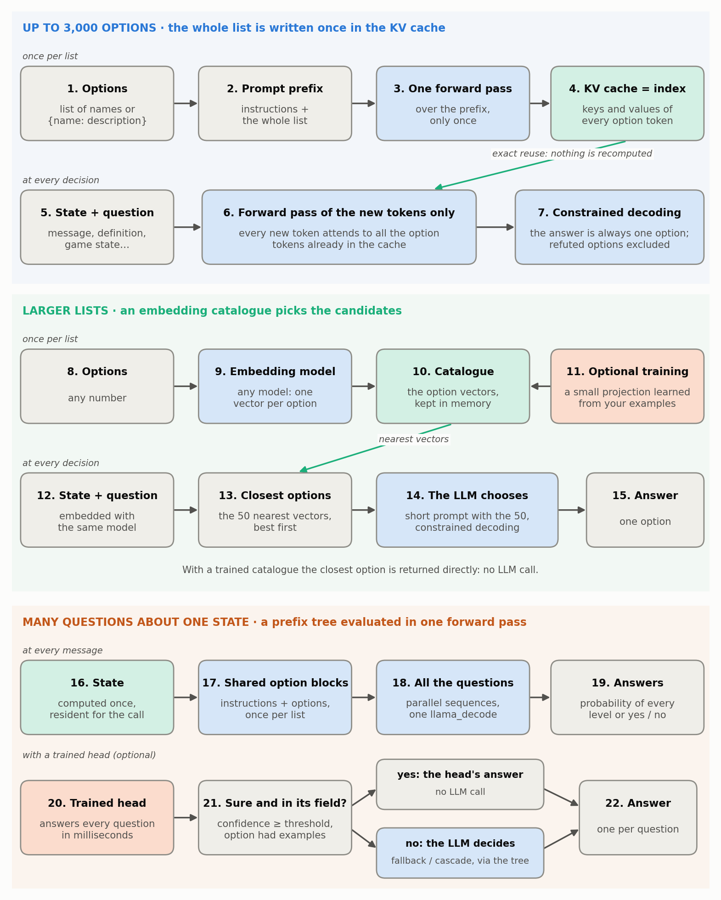
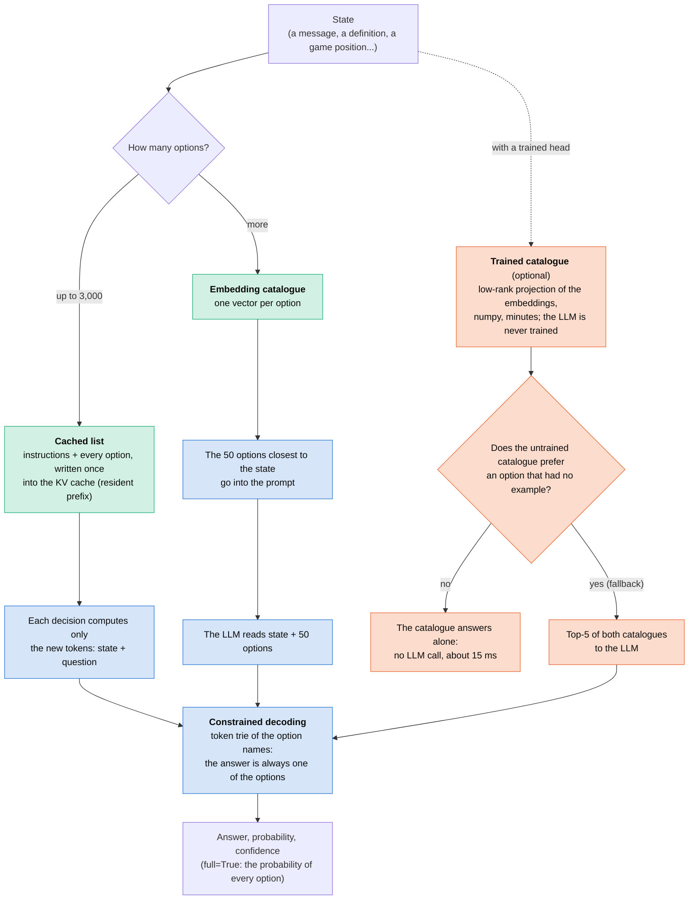
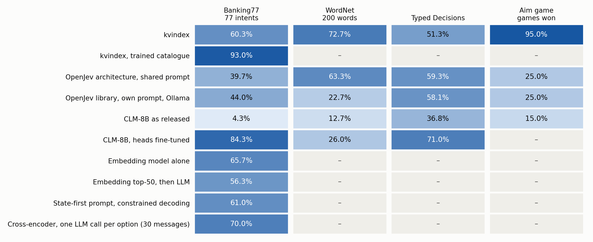
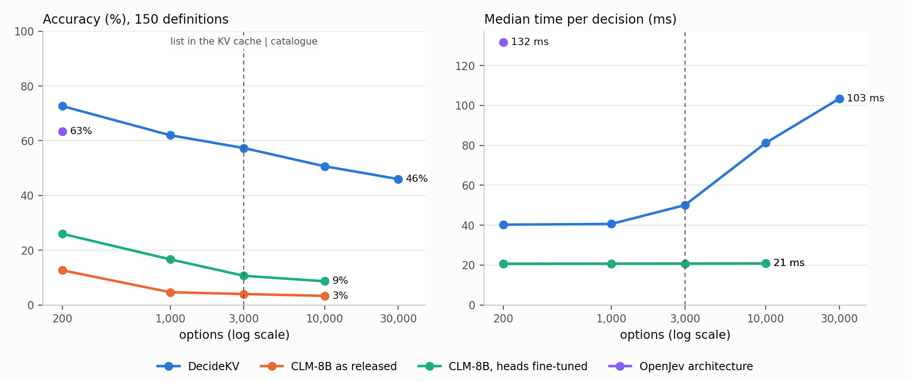

# DecideKV: a tool for fast decisions over many options with a local LLM

## Summary

Many programs need the same small decision again and again: given a state, pick one option out of a list. A
customer message goes to one of 77 intents; a definition names one of 30,000 words; an agent picks the next tool.
`decidekv` is a Python library that makes this decision with a local LLM in 15 to about 100 milliseconds, for lists
from two options to tens of thousands, without training the LLM.

The library does not introduce a new mechanism. It assembles published techniques behind one call:

- up to 3,000 options, the list is written once into the KV cache of the model and each decision computes only the
  tokens of the new state;
- above 3,000 options, an embedding catalogue selects the 50 closest options and the LLM chooses among them;
- when examples of the task exist, the catalogue can be trained on them in about a minute, with numpy only.

On one consumer GPU and one 8B model, the untrained tool is ahead of the OpenJev architecture on three tasks out of
four, runs on lists where OpenJev does not, and is far ahead of CLM-8B as released. With the catalogue trained on
Banking77 it reaches 93.0% in 16 ms per decision, above CLM-8B with heads fine-tuned on the same task (84.3%). On
Typed Decisions the catalogue trained on the typed questions reaches 75.6% with no LLM call (CLM-8B fine-tuned:
71.0%), and trained on the answers of an LLM, without any human label, it keeps about the accuracy of its teacher.

## The decision

A decision has three parts: a fixed list of options, a state that changes at every call, and a question. The
answer must be one of the options. Three properties matter in practice: the accuracy of the choice, the time per
decision, and how both change when the list grows.

## What the tool does



**Cached list.** The prompt starts with the instructions and the whole list of options, followed by the state and
the question. In a causal LLM the keys and values of a token depend only on the tokens before it, so the cache of
the list is computed once and reused exactly by every later call. The list is a *resident prefix*: it lives in a
sequence of its own and is copied into the working sequence at every decision (cache cells are shared, a recurrent
state is copied), which makes the reuse available on models with recurrent layers too, and lets several lists stay
resident at the same time. On models with recurrent layers llama.cpp slows down by an order of magnitude
beyond eight sequences in total, so seven lists are resident by default. A decision evaluates only the tokens of the state
and of the question; these tokens attend to every token of every option. The answer is decoded through a trie of
the option names, so it is always one of the options, and options already refuted can be excluded from the
decoding.

**Catalogue.** The cache of the list grows with the list: about 78 KB per token for Qwen3-8B with an 8-bit cache.
Above a few thousand options the list stops fitting in the trained context of the model and then in memory. For
these lists the tool keeps one embedding vector per option, finds the 50 options closest to the state, and writes
only these in the prompt. This is the standard retrieve-then-rerank pipeline.

**Trained catalogue.** With examples of the form (state, right option), a low-rank correction of the embedding
space is learned for states and for options. It starts as the identity, so training starts from the untrained
catalogue; the weights of the best validation epoch are kept and the validation accuracy before and after is
reported. Only this projection is trained. With a trained catalogue the closest option is returned directly.

`KV.index` chooses between the first two regimes from the size of the list; the threshold is a parameter.

The flow of one decision, with the optional trained catalogue and its fallback:



## Prior work

Every mechanism above is published work.

- Putting the candidates first and encoding them once thanks to prefix caching is Corpus-in-Context prompting
  (LOFT, Lee et al., 2024).
- Reusing a precomputed KV cache across queries is Cache-Augmented Generation (Chan et al., 2024); per-block
  precomputed caches appear in TurboRAG, KVLink and CacheBlend.
- Decoding constrained to candidate names with a token trie is GENRE (De Cao et al., 2021).
- An embedding shortlist followed by an LLM choice is the standard retrieve-then-rerank pipeline.
- Contrastive training of state and option projections follows InfoNCE (van den Oord et al., 2018) and CLIP
  (Radford et al., 2021), and is the design of Contrastive Language Models (CLM-v0.1-8B).
- The low-rank correction with an identity start has the form of LoRA (Hu et al., 2021).
- The `Choice` / `Score` / `Noul` question types are those of OpenJev (MIT licence). The library contains no OpenJev
  code.

The contribution of the repository is the tool: one interface that selects the regime by size, the exclusion of
refuted options, a catalogue training that needs only numpy, and measurements that report accuracy and time
together.

## Measurement protocol

- **Machine and model.** One RTX 4070 SUPER (12 GB). Qwen3-8B through llama.cpp in the Python process, KV cache
  `q8_0`. Embedding model of the catalogue: Qwen3-Embedding-4B.
- **Equal conditions.** Every method measured by `benchmarks/baselines.py` uses the same model, engine, queries and
  prompt blocks (instructions, option list, state, question); the methods differ only in the order of the blocks
  and in how the answer is read.
- **Tasks.** Banking77: 77 intents, 300 test messages. WordNet reverse dictionary: a definition must be matched to
  its word among 200 to 30,000 candidate nouns. Typed Decisions: 2,000 typed questions about agent traces. Aim game:
  a hidden cell on a 15×15 grid, a direction hint after every miss, at most 25 shots, 20 games.
- **Numbers.** Accuracy and the median time of one decision, always together. With 600 queries one accuracy has a
  standard error of about 2 points; with 150 queries, about 4. Times vary between sessions on the same machine: the
  same configuration at 10,000 options measured between 84 and 99 ms on one day, with identical accuracy in every
  repetition.
- **Reference rows.** The OpenJev library (its own prompt, through the Ollama server) and CLM-8B (Qwen3-8B with the
  released CLM-v0.1-8B heads, as released and with heads fine-tuned on the task) were measured earlier on the same
  machine and weights with scripts that are not part of the repository; their numbers are in
  `results/reference_qwen3_8b.json`. The row "OpenJev architecture" is a re-implementation of OpenJev's design on the
  shared prompt and engine, not the OpenJev library.

## Results

### Comparison

<!-- table:comparison -->
| Method | Training | Banking77 (77 intents) | WordNet (200 words) | Typed Decisions | Aim game (games won, time per shot) |
|---|---|---|---|---|---|
| **DecideKV** | none | 60.7% · 65 ms | 70.7% · 38 ms | 56.7% · 41 ms | 95.0% · 159 ms |
| **DecideKV, trained catalogue** | on the task | 93.0% · 16 ms | – | 75.6% · 57 ms | – |
| OpenJev architecture, shared prompt | none | 39.7% · 90 ms | 63.3% · 132 ms | 59.3% · 67 ms | 25.0% · 423 ms |
| OpenJev library, own prompt, Ollama | none | 44.0% · 117 ms | 22.7% · 164 ms | 58.1% · 62 ms | 25.0% · 469 ms |
| CLM-8B as released | none | 4.3% · 35 ms | 12.7% · 21 ms | 36.8% · 79 ms | 15.0% · 124 ms |
| CLM-8B, heads fine-tuned | on the task | 84.3% · 21 ms | 26.0% · 21 ms | 71.0% · 79 ms | – |
| Embedding model alone | none | 65.7% · 16 ms | – | – | – |
| Embedding top-50, then LLM | none | 56.3% · 127 ms | – | – | – |
| State-first prompt, constrained decoding | none | 61.0% · 138 ms | – | – | – |
| Cross-encoder, one LLM call per option (30 messages) | none | 70.0% · 1,589 ms | – | – | – |
<!-- /table:comparison -->



Without training, DecideKV is ahead of the OpenJev architecture on Banking77, WordNet and the aim game, and behind
it on Typed Decisions, where every case asks five different questions with few options each. CLM-8B as released is
below both on the four tasks; with heads fine-tuned on the task it is ahead of untrained DecideKV on Banking77 and
Typed Decisions. The trained catalogue of DecideKV is ahead of it on both. On Typed Decisions DecideKV answers the
five questions of a case in one `decide` call, which puts the state first (the default); one question per call with
the options first gives 51.1% (see the section on prompt order).

### The same comparison on a hybrid 27B model

Qwen3.8-27B (IQ2_S, architecture `qwen35`: recurrent and attention layers). Same tasks, prompt and engine; CLM-8B
cannot run here because its released heads belong to Qwen3-8B. Context of 8,192 tokens for Typed Decisions and the
aim game, so that the 9.3 GB of weights and the cache fit in 12 GB:

<!-- table:hybrid27b -->
| Method | Banking77 (77 intents) | WordNet (200 words) | Typed Decisions | Aim game (games won, time per shot) |
|---|---|---|---|---|
| **DecideKV** | 73.0% · 161 ms | 82.7% · 106 ms | 70.4% · 193 ms | 100.0% · 340 ms |
| OpenJev architecture, shared prompt | 45.7% · 409 ms | 84.0% · 600 ms | 69.1% · 307 ms | not measured: over two hours (the whole grid is recomputed at every shot) |
<!-- /table:hybrid27b -->

With a 16,384-token context the same aim game took 1.25 s per shot on this model: the weights and the cache
filled the 12 GB and part of the cache spilled into system memory. Keep `n_ctx` to what the lists need.

### Growing lists

<!-- table:scale -->
| Options | Index chosen by `KV.index` | Accuracy | Time per decision | Index build | Right answer among the 50 candidates |
|---|---|---|---|---|---|
| 1,000 | Index | 66.7% | 43 ms | 1 s | – |
| 3,000 | Index | 56.3% | 51 ms | 2 s | – |
| 10,000 | TopKIndex | 54.0% | 96 ms | 13 s | 89.5% |
| 30,000 | TopKIndex | 51.5% | 105 ms | 34 s | 86.5% |
<!-- /table:scale -->

The time per decision goes from about 40 ms at 1,000 options to about 100 ms at 30,000. Building the index takes
seconds: one pass over the list, or one embedding per option. Accuracy falls as the candidates multiply.

<!-- table:scale150 -->
| Options | DecideKV | OpenJev architecture | CLM-8B as released | CLM-8B, heads fine-tuned |
|---|---|---|---|---|
| 200 | 72.7% · 40 ms | 63.3% · 132 ms | 12.7% · 21 ms | 26.0% · 21 ms |
| 1,000 | 62.0% · 41 ms | not supported (max 255) | 4.7% · 21 ms | 16.7% · 21 ms |
| 3,000 | 57.3% · 50 ms | not supported (max 255) | 4.0% · 21 ms | 10.7% · 21 ms |
| 10,000 | 50.7% · 81 ms | not supported (max 255) | 3.3% · 21 ms | 8.7% · 21 ms |
| 30,000 | 46.0% · 103 ms | not supported (max 255) | not measured | not measured |
<!-- /table:scale150 -->



In the right panel the two CLM-8B lines coincide: the fine-tuned heads cost the same forward pass.

### Training the catalogue

<!-- table:training -->
| Banking77, 300 test messages | Untrained catalogue | Trained catalogue |
|---|---|---|
| Catalogue alone (no LLM call) | 65.7% · 15 ms | 93.0% · 16 ms |
| Catalogue top-5, then LLM | 61.7% · 84 ms | 61.0% · 84 ms |
| Catalogue top-50, then LLM | 56.0% · 126 ms | 53.3% · 125 ms |
| Validation accuracy during training | 71.2% | 92.4% |
| Cost of training | – | 10,003 examples, 94 s in total (18 s of training, the rest is embedding the examples) |
<!-- /table:training -->

Three facts follow from the table.

1. Training raises the accuracy of the catalogue from 65.7% to 93.0% on the test messages.
2. It does not change the time per decision: 15 to 16 ms, the cost of one embedding.
3. After training, the catalogue alone is more accurate than the catalogue followed by the LLM. The LLM, which is
   not trained on the task, lowers the result when it re-chooses among good candidates.

For this reason an index built with a trained catalogue answers without calling the LLM unless asked otherwise.

A catalogue trained with the examples of half of the intents only:

<!-- table:heldout -->
| Intent of the test message | Untrained catalogue | Trained on half of the intents, no fallback | Trained on half of the intents, fallback (default) | Decisions that fell back to the LLM |
|---|---|---|---|---|
| Had training examples (39 intents) | 66.0% · 15 ms | 95.4% · 15 ms | 86.3% · 16 ms | 15.0% |
| Had no training example (38 intents) | 65.3% · 15 ms | 21.1% · 15 ms | 59.9% · 83 ms | 63.9% |
<!-- /table:heldout -->

Without the fallback the head trained on half of the intents gets the other half wrong: it picks an intent it
was trained on, with high confidence, so the confidence cannot flag these errors. The fallback uses another signal:
the head records which options had examples, and when the untrained catalogue prefers an option without examples
and disagrees with the trained one, the LLM chooses among the 5 best options of each catalogue. On the intents
without examples this raises the accuracy from 21.1% to 59.9%; on the intents with examples it costs 9 points,
because the LLM re-chooses some cases the trained catalogue had right. Over all 300 messages: 59.0% without the
fallback, 73.3% with it, 65.7% for the untrained catalogue. A head trained on every option never falls back (93.0%
in 16 ms, as above). `fallback=0` switches it off.
A trained catalogue works best when the examples cover the options.

### Training the catalogue on typed questions

The same catalogue can learn questions of type `Choice`, `Score` and `Noul`, each with its own options
(`kv.train_questions`). Every example gives a target distribution over the options of its question: a one-hot
vector for a hard label, the official distribution for a soft label, or the probabilities that an LLM assigns to
every option (`kv.teach`). The loss is the cross-entropy between that distribution and the catalogue's softmax over
the same options. Typed Decisions: training split of 1,200 cases (6,000 decisions), test split of 400 cases (2,000
decisions); the trained catalogue answers alone, with no LLM call.

<!-- table:typedtrain -->
| Typed Decisions, 2,000 test decisions | Labels used for training | Accuracy · time per decision |
|---|---|---|
| Catalogue alone, untrained | none | 44.5% · 57 ms |
| Catalogue alone, trained on the official answers | 6,000 human labels (most probable answer) | 75.4% · 57 ms |
| **Catalogue alone, trained on the official distributions** | 6,000 human labels (soft) | 75.6% · 57 ms |
| Catalogue alone, trained on the answers of Qwen3-8B (`kv.teach`) | none (the 8B labels the training states in 6 min) | 50.4% · 57 ms |
| Catalogue alone, trained on the answers of Qwen3.8-27B (`kv.teach`) | none (the 27B labels the training states in 42 min) | 66.6% · 57 ms |
| Same, state embedded once (`layout="state-once"`), official distributions | 6,000 human labels (soft) | 67.2% · 9 ms |
| Same, state embedded once, answers of Qwen3.8-27B | none | 60.8% · 9 ms |
| *DecideKV with Qwen3-8B, no catalogue* | none | 56.7% · 41 ms |
| *DecideKV with Qwen3.8-27B, no catalogue* | none | 70.4% · 193 ms |
| *CLM-8B, heads fine-tuned* | 6,000 human labels | 71.0% · 79 ms |
<!-- /table:typedtrain -->

1. With the human labels the catalogue alone is the most accurate method measured on this task, ahead of CLM-8B
   with fine-tuned heads, at 57 ms per decision. Soft and hard labels end within 0.2 points of each other.
2. Without any human label, the catalogue trained on the answers of an LLM reproduces its teacher: 50.4% against
   51.1% for the 8B teacher, 66.6% against 69.6% for the 27B teacher (the teachers' scores with the options-first
   prompt they labelled with). For the 27B this replaces 188 to 249 ms per decision with 57 ms, after a labelling
   pass of 42 minutes done once.
3. Training took 10 minutes, of which a little over 2 minutes of optimisation; the rest is embedding the examples.
4. `layout="state-once"` embeds the state once per call and puts each question in its option texts (cached): about
   six times faster (9 ms against 57 ms per decision), but 6 to 8 points less accurate, because one state vector
   compared with options that contain the question captures the relation between question and state less well. The
   default stays the per-question layout.

### Cascade: trained catalogue first, LLM for the uncertain answers

Typed Decisions on Qwen3.8-27B. The head answers every question; the questions whose answer has a confidence (1 -
normalised entropy) below the threshold go to the LLM in one `decide` call. The 27B model and the embedding model
do not fit together in 12 GB, so `benchmarks/cascade_bench.py` stores the catalogue's answers and times first and
then runs the LLM on the questions below each threshold; the times are added.

<!-- table:cascade -->
| Threshold | Head trained on the answers of the 27B (`kv.teach`) | Head trained on the human labels |
|---|---|---|
| 0 (catalogue alone) | 66.6% · 58 ms (0.0% to the LLM) | 75.6% · 59 ms (0.0% to the LLM) |
| 0.3 | 68.9% · 191 ms (46.5% to the LLM) | 73.4% · 186 ms (58.5% to the LLM) |
| 0.5 | 71.3% · 251 ms (71.4% to the LLM) | 71.0% · 237 ms (80.6% to the LLM) |
| 0.7 | 71.3% · 281 ms (84.5% to the LLM) | 70.2% · 254 ms (92.6% to the LLM) |
| 0.9 | 70.0% · 297 ms (95.3% to the LLM) | 70.8% · 299 ms (98.5% to the LLM) |
| 1.01 (every question to the LLM) | 70.2% · 260 ms (100.0% to the LLM) | 70.6% · 307 ms (100.0% to the LLM) |
<!-- /table:cascade -->

With a head trained on the answers of the same LLM, the cascade at threshold 0.5 is slightly more accurate than the
LLM alone and a little faster: where the head is confident it corrects some answers of the LLM. At 0.3 half of the
questions never reach the LLM. With a head trained on human labels, which is more accurate than the LLM on this
task, every question sent to the LLM lowers the accuracy: a cascade pays when the LLM is the better judge.

### Several questions about one state: prompt order

With the options first, a call answers one question and the state is computed for each question. When a call has
several questions with short option lists, `decide` now puts the state first: the state becomes a resident prefix
shared by the questions of the call and is freed at the end, and the instructions and options of each question
follow it. On Typed Decisions the five questions of a case go in one call:

<!-- table:order -->
| Typed Decisions, 2,000 decisions | Qwen3-8B | Qwen3.8-27B (hybrid) |
|---|---|---|
| Options first, one question per call | 51.1% · 62 ms | 69.6% · 249 ms |
| **State first, the five questions of a case in one call** (`decide` default) | 56.7% · 41 ms | 70.4% · 193 ms |
| OpenJev architecture (state first, one question per call) | 59.3% · 67 ms | 69.1% · 307 ms |
<!-- /table:order -->

The state-first order is more accurate on both models, which agrees with the OpenJev architecture being ahead of
the options-first order on this task with Qwen3-8B. It is also faster, because the five questions share the state.

A turn of 15 questions about one state, with a short and a long state (the states of nine cases):

<!-- table:turn -->
| Turn of 15 questions (4 `Score`, 11 `Noul`) on one state | Short state (99 characters) | Long state (3,177 characters) |
|---|---|---|
| Qwen3-8B, options first | 330 ms | 2,537 ms |
| Qwen3-8B, state first (`auto`) | 171 ms | 329 ms |
| Qwen3-8B on `llama-server`, options first | 430 ms | 904 ms |
| Qwen3-8B on `llama-server`, state first (`auto`) | 466 ms | 615 ms |
| Qwen3.8-27B (hybrid), options first | 1,198 ms | 11,105 ms |
| Qwen3.8-27B (hybrid), state first (`auto`) | 916 ms | 1,591 ms |
<!-- /table:turn -->

In process the questions that share the state are answered as a prefix tree: the state is evaluated once, the
instructions and options of a list used by several questions once (here one block for the 4 `Score` and one for the
11 `Noul`), and the questions themselves in parallel sequences of one `llama_decode`. With a long state this is
about eight times faster than the options-first order on Qwen3-8B and seven times on the 27B; with a very short state
it is still faster (171 against 330 ms, 916 against 1,198 ms). On the hybrid 27B llama.cpp slows down beyond eight
sequences, so the questions run five at a time and the gain is smaller. Questions answered by option name (`Choice`
with labels off) are decoded token by token and stay outside the batch. Every turn has a new state, so no engine
can reuse the state of the previous turn.

On `llama-server` there is no prefix tree: the questions go one by one, and the server reuses the common prefix of
consecutive prompts in a slot (the 11 `Noul` questions share a slot, state included), which is why its options-first
order loses less with a long state.

### Resident prefix on any architecture

100 Banking77 messages, the same model with the option list resident in the cache and with the whole prompt
recomputed at every decision:

<!-- table:engine -->
| Model | Architecture | Banking77, list resident | Banking77, prompt recomputed |
|---|---|---|---|
| Qwen3-8B (36 attention layers) | qwen3 | 63.0% · 65 ms | 66.0% · 137 ms |
| Qwen3.8-27B (hybrid: recurrent + attention layers, IQ2_S) | qwen35 | 76.0% · 161 ms | 76.0% · 475 ms |
| Qwen3-8B on `llama-server` (8 slots) | qwen3 | 63.0% · 75 ms | not measured |
<!-- /table:engine -->

On Qwen3-8B the two Banking77 accuracies differ by three messages out of 100: llama.cpp evaluates the tail of the
prompt in one chunk after the resident prefix and the whole prompt in another grouping when it recomputes,
which moves probabilities by up to a few hundredths on near ties. On the hybrid model the numbers coincide.

On the hybrid model the resident prefix is the only reuse available: the engine cannot remove the tail of a
sequence, so without it every decision recomputes the list. The reuse is exact on both models (checks 3 to 5 of
`benchmarks/checks.py`: the logits equal those of decoding the same tokens without a cache, split at the same
point, and resident prefixes do not leak into each other). The split point matters: llama.cpp is not
batch-invariant, and on Qwen3-8B the same prompt evaluated whole, in two pieces or token by token gave the most
probable answer of an uncertain `Noul` question between 0.76 and 0.93 (smaller with flash attention off, but not
zero). Confident answers do not move.

## Limits

- The cached lists must fit in the context and in memory.
- Probabilities depend slightly on how llama.cpp splits the prompt into batches (see the engine section).
- `full=True` is not available on the llama-server engine.
- The probability of every option (`full=True`) costs as much as a greedy decision on Qwen3-8B (50 ms for 77
  options) and about 2.3 s on the hybrid 27B.
- The trained catalogue was measured on two datasets (Banking77, Typed Decisions).
- The reference rows were not re-measured under the shared prompt, except CLM-8B as released on Banking77 (same
  accuracy).

## Reproducing

```bash
python benchmarks/checks.py --baselines        # correctness checks, to run first
python benchmarks/baselines.py --task banking77
python benchmarks/baselines.py --task wordnet --sizes 200 --methods decidekv,openjev
python benchmarks/baselines.py --task typed --methods decidekv,decidekv-state,openjev
python benchmarks/baselines.py --task aim --methods decidekv,openjev
python benchmarks/scale.py --sizes 1000,3000,10000,30000
python benchmarks/scale.py --sizes 200,1000,3000,10000,30000 --queries 150 --core 200
python benchmarks/train_bench.py
python benchmarks/typed_train_bench.py --teachers qwen3:8b,hf.co/ISTA-DASLab/Qwen3.8-27B-GSQ-RCO-GGUF:IQ2_S
python benchmarks/engine_bench.py --models qwen3:8b,hf.co/ISTA-DASLab/Qwen3.8-27B-GSQ-RCO-GGUF:IQ2_S
python benchmarks/engine_bench.py --backend llamaserver --n-ctx 32768 --slots 8
python benchmarks/cascade_bench.py --phase catalogue
python benchmarks/cascade_bench.py --phase llm --llm hf.co/ISTA-DASLab/Qwen3.8-27B-GSQ-RCO-GGUF:IQ2_S --n-ctx 8192
python benchmarks/report.py                    # tables of this article and of the README
python paper/figures.py                        # figures
```

## References

- N. Wake, J. Wagle. *SharedKV-BT: Node-Local Typed Decisions for Behavior-Tree Agents*. arXiv:2610.07327, 2026.
  Concurrent work: the context is encoded once and the candidates of all the fields are scored in one batch.
- Y. Li, J. Wagle. *LLM-as-Jev: LLMs Are Already Jev-Style Decision Models — When and How to Fine-Tune Them*.
  arXiv:2610.02076, 2026. Concurrent work: Choice/Score/Noul by prefill alone with shared prefixes within a request.
- N. De Cao, G. Izacard, S. Riedel, F. Petroni. *Autoregressive Entity Retrieval* (GENRE). ICLR 2021.
- B. J. Chan, C.-T. Chen, J.-H. Cheng, H.-H. Huang. *Don't Do RAG: When Cache-Augmented Generation is All You Need
  for Knowledge Tasks*. 2024.
- E. J. Hu et al. *LoRA: Low-Rank Adaptation of Large Language Models*. 2021.
- J. Lee et al. *Can Long-Context Language Models Subsume Retrieval, RAG, SQL, and More?* (LOFT). 2024.
- A. van den Oord, Y. Li, O. Vinyals. *Representation Learning with Contrastive Predictive Coding* (InfoNCE). 2018.
- A. Radford et al. *Learning Transferable Visual Models From Natural Language Supervision* (CLIP). 2021.
- I. Casanueva et al. *Efficient Intent Detection with Dual Sentence Encoders* (Banking77). 2020.
- G. A. Miller. *WordNet: A Lexical Database for English*. Communications of the ACM, 1995.
- OpenJev: https://github.com/GPT-AGI/OpenJev. CLM-v0.1-8B: https://huggingface.co/Contrastive-LM/CLM-v0.1-8B.
  llama.cpp: https://github.com/ggml-org/llama.cpp.
